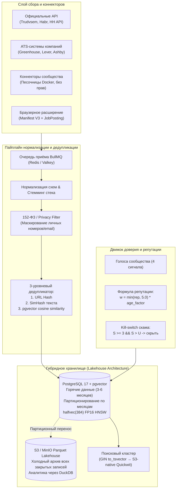

# OpenRadar — The Open-Source Global Labor & Order Intelligence Network

> **Манифест, продуктовая концепция и инженерная архитектура проекта**  
> **Версия документа:** 1.0 (Октябрь 2026)  
> **Live Demo:** [https://radar.91.229.8.32.nip.io](https://radar.91.229.8.32.nip.io)  
> **Исходный код:** [github.com/MikhailSagalaev/radar-oss](https://github.com/MikhailSagalaev/radar-oss)

---

## 1. Executive Summary (Суть на одной странице)

**OpenRadar** — это открытая, децентрализованная альтернатива закрытым монополиям рынка труда (HeadHunter, Upwork, Kwork, FL, LinkedIn). 

Мы создаём **«Wikipedia + Bloomberg для вакансий и заказов»**: открытую базу данных масштаба 1 миллиарда записей, куда данные стекаются из тысяч открытых источников, официальных API, скраперов сообщества и браузерных расширений, а чистота, отсутствие скама и актуальность регулируются **коллективным интеллектом и репутационным голосованием сообщества**.

### Проблема рынка
1. **Фрагментация («Колодцы»):** Чтобы найти работу или контракт, соискатель/фрилансер вынужден мониторить 10 бирж, 5 джоб-бордов и десятки закрытых Telegram-каналов.
2. **Монетизация мусора:** Платформы берут деньги за размещение с работодателей, поэтому им **выгодно** годами не закрывать неактуальные вакансии и пропускать сомнительные заказы ради раздувания поисковой выдачи и удержания трафика.
3. **Платный доступ к человеку:** Плата за просмотр контактов, плата за отклики (Connects на Upwork), скрытые комиссии. Рынок труда превратился в налог на поиск работы.

### Наше решение
- **Открытый слой данных (Open Data Layer):** Нулевая комиссия за поиск, просмотр и контакт. Вся информация агрегируется в едином окне со ссылкой на первоисточник.
- **Самоочищение сообществом (Community Curation):** Вместо непрозрачных алгоритмов модерации — взвешенные голоса участников (`Полезно`, `Мусор`, `Скам`, `Закрыто`), где вес голоса зависит от прозрачной ончейн/офчейн репутации.
- **Федеративная модель (Hub + Nodes):** Каждый может поднять свой изолированный радар (Self-Hosted Node) для личного пайплайна или подключиться к общему всемирному Хабу.

---

## 2. Продуктовая концепция и User Flow

```
[ Пользователи интернета ] ──> Браузерное расширение (1 клик) ──┐
[ Сообщество разработчиков] ──> Открытые коннекторы (PR)      ──┼──> [ OpenRadar Ingestion Gateway ]
[ Корпоративные ATS / API ] ──> Официальные фиды              ──┘                    │
                                                                                     ▼
                                                                        [ Дедуп + Склейка + PII Clean ]
                                                                                     │
                                                                                     ▼
[ Сообщество участников ] <── Голосование за качество (+ / -) <── [ Единая глобальная библиотека ]
```

### Основные сценарии использования

1. **Для соискателя и фрилансера:**
   - Единая строка поиска по всему мировому и локальному рынку с русским/английским стеммингом и горячей клавишей `/`.
   - Мгновенное переключение между постоянной работой (`Вакансии / job`) и проектным фрилансом (`Заказы / gig`).
   - Фильтрация по честным вилкам зарплат, стеку технологий и формату (удалёнка / гибрид / офис).
   - Внутренняя воронка откликов: `Новый` → `Интересно` → `Откликнулся` → `В работе` → `Архив`.

2. **Вклад в один клик (Краудсорсинг данных):**
   - Увидел вакансию или заказ на любом закрытом сайте, в соцсети или чате → нажал `Alt+Shift+R` в расширении.
   - Расширение автоматически парсит микроразметку `schema.org/JobPosting` (компания, вилка, стек, город) и отправляет в OpenRadar.
   - За каждую полезную запись контрибьютор получает рост репутации.

3. **Коллективная модерация:**
   - 4 простых сигнала под каждой карточкой: `Полезно`, `Мусор`, `Скам`, `Закрыто`.
   - Если работодатель закрыл вакансию или оказался мошенником — голоса сообщества мгновенно вымывают карточку из поисковой выдачи для всех остальных.

---

## 3. Инженерная архитектура (Scale to 1 Billion Records)

Система изначально спроектирована под объём в миллиард записей без неподъёмных затрат на инфраструктуру.



### Ключевые архитектурные решения (2026 Tech Stack)

1. **PostgreSQL 17 + pgvector с типом `halfvec` (FP16):**
   - Использование половинной точности `halfvec(384)` для эмбеддингов позволяет хранить векторные индексы HNSW в оперативной памяти с **двукратной экономией RAM** при сохранении точности схожести >99.2%.
2. **Кросс-платформенная склейка дубликатов:**
   - Если один проект опубликован на HH, Хабре и в Telegram-канале, дедупликатор склеивает их в одну каноническую карточку: *«Найдено на 3 площадках: Habr, HH, Telegram»*, экономя время соискателя.
3. **Холодный слой на DuckDB + Parquet:**
   - Горячая база (последние 3–6 месяцев, 50–100 млн записей) обслуживается на быстрых NVMe дисках в PostgreSQL.
   - Всё, что закрыто или старше полугода, автоматически партициями выгружается в сжатый Parquet на S3. Затраты на хранение миллиарда строк снижаются в десятки раз. DuckDB позволяет строить отчёты и аналитику зарплат прямо поверх S3 за секунды.
4. **S3-Native Search (Quickwit):**
   - Полнотекстовый поиск по архиву строится не на тяжеловесном RAM-hungry Elasticsearch, а на движке Quickwit (Rust), хранящем инвертированные индексы непосредственно в объектном хранилище.
5. **Безопасность и 152-ФЗ:**
   - В публичную базу **никогда не попадают** личные телефоны, мессенджеры и email физических лиц. Модуль `src/core/privacy.ts` маскирует персональные данные регулярными выражениями (NER-обогащение — в бэклоге). Соискатель переходит за контактом по ссылке на оригинальную площадку.

---

## 4. Математика скоринга и защита от накруток

Итоговый рейтинг привлекательности вакансии/заказа рассчитывается по объективной формуле:

$$\text{Score} = 0.4 \times \text{Quality}_{\text{model}} + 0.4 \times \text{Community} + 0.2 \times \text{Freshness}$$

Где:
- $\text{Quality}_{\text{model}}$ — базовая оценка полноты данных (наличие понятного ТЗ, вилки оплаты, отсутствие стоп-слов мошенников).
- $\text{Freshness} = \exp(-\frac{\Delta t}{14})$ — экспоненциальное затухание свежести.
- $\text{Community}$ — взвешенное сглаженное мнение сообщества:

$$\text{Community} = \frac{U - J - 3S}{U + J + S + 2} \in [-1, 1]$$

- $U$ — сумма весов голосов «Полезно» (Useful);
- $J$ — сумма весов голосов «Мусор» (Junk);
- $S$ — сумма весов голосов «Скам» (Scam);
- $C$ — голоса «Закрыто» (Closed).

### Механизмы защиты (Anti-Sybil / Anti-Abuse)
- **Вес голоса:** $w = \min(\text{Reputation}, 5.0) \times \text{AgeFactor}$.
- **Карантин для новичков:** Голоса аккаунтов моложе 7 дней или с репутацией ниже порога учитываются с задержкой в 24 часа и начальным весом $0.3$.
- **Мгновенный Kill-switch:** Если $S \ge 3$ и $S > U$, объявление скрывается из поисковой выдачи автоматически до решения модератора.

---

## 5. Дизайн-код и философия интерфейса

В проекте принята строгая концепция **Zero Bullshit & Zero Emoji**:
- Интерфейс выдержан в стиле строгой швейцарской типографики (эстетика современных интерфейсов OpenAI, xAI, Linear).
- Полный отказ от эмодзи, градиентных баннеров и навязчивых поп-апов.
- Чёткое разделение элементов тонкими линиями (`border: 1px solid var(--line)`).
- Мгновенная навигация: фокус на поисковую строку по нажатию клавиши `/`, моментальный отклик серверного рендеринга (Hono SSR, TTFB < 25 мс).

---

## 6. Текущее состояние разработки (Что уже работает в продакшене)

Проект прошёл стадию концепта и **уже развёрнут и протестирован на боевом сервере**:

- **Стек:** Node.js 22 LTS, TypeScript, Hono, PostgreSQL 17 + `pgvector halfvec(384)`, Docker Compose.
- **Публичный адрес:** [https://radar.91.229.8.32.nip.io](https://radar.91.229.8.32.nip.io) (просмотр открыт, действия — после входа).
- **Авторизация:** вход через GitHub OAuth; голосование и добавление лидов через `/submit` доступны только зарегистрированным участникам — один голос на сигнал с весом 1.0 (`lead_votes`), репутационный движок — следующий шаг.
- **База данных:** Полная миграция на PostgreSQL 17 (SQLite вычищен), события пайплайна пишутся в `outbox_events` (консюмер для хаб-синхронизации — в роадмапе), сессии в HttpOnly/Secure cookies.
- **Поиск:** Полнотекстовый GIN-индекс с русским стеммингом (`to_tsvector`).
- **Сбор:** Работают адаптеры RSS (FL.ru, Хабр Карьера, We Work Remotely), Kwork, Telegram-каналы, официальный API «Работа России» (Trudvsem), HeadHunter Open API, RemoteOK, IMAP и входящие webhooks.
- **Расширение:** Manifest V3 расширение с автоматическим парсером `schema.org/JobPosting`.
- **Инструментарий контрибьютора:** CLI-генератор коннекторов `pnpm new:connector <name>`.
- **Тесты:** 87 автоматических тестов (100% pass) + сквозной E2E-тестер.

---

## 7. Дорожная карта (Roadmap)

| Этап | Сроки | Фокус | Ключевые результаты |
|---|---|---|---|
| **Этап 1 (Core)** | **Готово ✅** | Инженерия и стабильность | Postgres 17, GIN поиск, сессии, SSRF-защита, воронка статусов, outbox, CI. |
| **Этап 2 (Extension & Ingest)** | **Q4 2026** | Расширение для людей | Публикация в Chrome Web Store / Firefox Add-ons, авто-детекция JobPosting, тосты подтверждения. |
| **Этап 3 (Community Hub)** | **Q1 2027** | Сетевой эффект | Авторизация через Telegram Login / GitHub, интерфейс 4 сигналов голосования, репутационный движок, 25 открытых коннекторов. |
| **Этап 4 (Scale 1B)** | **Q2 2027** | Big Data & Lakehouse | BullMQ на Valkey/Redis, партиционный архив в S3 Parquet, DuckDB аналитика, S3-native Quickwit search. |

---

## 8. Почему этот проект победит (Unfair Advantage)

1. **Нет конфликта интересов:** Обычным доскам объявлений платят за размещение, поэтому они никогда не решат проблему спама и мёртвых вакансий. Нам никто не платит за размещение — наш единственный стимул это максимальная релевантность для соискателя.
2. **Сетевой эффект Open-Source:** Тысячи разработчиков могут подключить свои локальные биржи и сайты компаний через простой интерфейс адаптера из одного файла (`pnpm new:connector`).
3. **Минимальная стоимость инфраструктуры:** Благодаря связке Postgres 17 + `pgvector halfvec` + S3 Parquet, поддержание базы на сотни миллионов вакансий обходится в сотни долларов в месяц, а не в десятки тысяч, как у классических корпораций.
