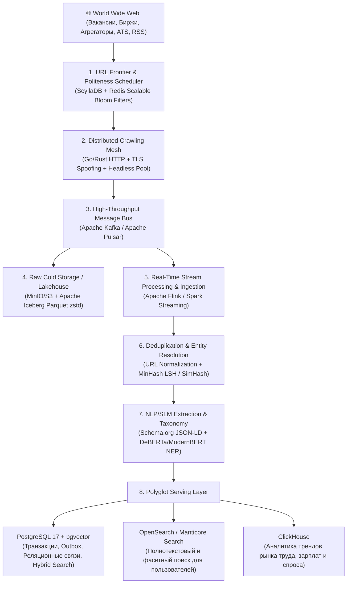

# Planetary-Scale Job & Lead Intelligence Architecture
## Манифест масштабирования Radar: от легковесного узла к распределенной системе на миллиарды записей

Данный документ описывает целевую архитектуру распределенной событийно-ориентированной платформы (**Event-Driven Architecture**) для глобального мониторинга, нормализации, дедупликации и семантического поиска миллиардов вакансий и заказов по всему миру.

---

## 1. Концептуальный пайплайн системы

---

## 2. Подсистема сбора: URL Frontier и краулеры

### 2.1. Управление очередями обхода (URL Frontier)
- **Двухуровневая очередь:**
  1. *Внешняя очередь (Priority Queue):* ранжирует целевые домены по авторитетности, частоте обновлений и качеству лидов.
  2. *Внутренняя очередь (Politeness Queue):* группирует задачи по `host_hash(domain)`, жестко соблюдая таймауты между запросами к одному хосту (delay, max concurrency).
- **Дедупликация ссылок:**
  - `Scalable Bloom Filters` в памяти (Redis / Valkey) для проверки 99.9% новых URL за субмиллисекунды.
  - Персистентный слой в **ScyllaDB** (LSM-tree Key-Value) по ключу `xxHash64(canonical_url)`.

### 2.2. Каскадный краулинг (Cost-effective Scraping)
- **Layer 1 (90% трафика):** сверхбыстрые легковесные HTTP-клиенты (Go / Rust) с поддержкой кастомных отпечатков TLS (uTLS, JA3/JA4 spoofing, HTTP/2 frames) для прозрачного прохождения WAF (Cloudflare, DataDome, Incapsula).
- **Layer 2 (10% трафика):** изолированный пул Chromium/Playwright-воркеров, запускаемый только по требованию (когда статический DOM пуст или требует рендеринга JS/SPA).
- **Прокси-менеджмент:** распределенный пул мобильных, резидентных и серверных прокси с умной ротацией по кодам ответа (`403 Forbidden`, `429 Too Many Requests`, `Captcha`).

---

## 3. Дедупликация и Entity Resolution

Одна и та же вакансия на рынке дублируется десятки раз (агрегаторы, доски объявлений, зеркала, репосты в Telegram).

| Уровень | Метод | Описание |
| :--- | :--- | :--- |
| **Синтаксический (Exact)** | Canonical URL + SHA-256 | Удаление UTM-меток, `fbclid`, сессий. Хэширование очищенного текста. |
| **Нечеткий (Near-Duplicate)** | MinHash LSH / SimHash | Текст разбивается на 3-граммы (shingles). При расстоянии Хэмминга $\le 3$ вакансии объединяются в кластер. |
| **Семантический (Entity Resolution)** | Taxonomy & Company Normalizer | Приведение компании (`ООО Рога и Копыта`, `Roga & Kopyta LLC` $\rightarrow$ `company_id: 4892`). Нормализация грейда и локации. |

---

## 4. NLP/ML Пайплайн извлечения и нормализации

Использование тяжелых проприетарных LLM (GPT-4) на миллиарде записей экономически разорительно. Пайплайн строится на экономичной каскадной модели:

1. **Schema.org / JSON-LD First (0% CPU cost):** мгновенный парсинг структурированной микроразметки `JobPosting`, если она присутствует в HTML.
2. **Small Language Models (SLM) & NER:** локальные компактные дистиллированные модели (ModernBERT, RoBERTa, DeBERTa-v3) на GPU:
   - Извлечение вилок зарплат и приведение к единой валюте с учетом инфляции/курса.
   - Нормализация стека технологий (приведение синонимов `k8s`, `kube`, `kubernetes` к единому ID).
   - Определение грейда (`Intern`, `Junior`, `Middle`, `Senior`, `Lead`, `C-Level`).
3. **Международные классификаторы (Taxonomy Mapping):** привязка к онтологиям **ESCO** и **O*NET**.

---

## 5. Polyglot Storage: Роли баз данных

| Слой | СУБД | Назначение в архитектуре |
| :--- | :--- | :--- |
| **Cold Raw Data** | S3 / MinIO + Apache Iceberg | Дешевое долговременное хранение сырого HTML и WARC-файлов в сжатом Parquet (zstd). Возможность полного репроцессинга архива. |
| **Hot State & Frontier** | ScyllaDB / Cassandra | Хранилище миллиардов состояний краулера, очереди обхода, быстрый Key-Value доступ по URL/ID. |
| **OLTP & Core Entity Store** | **PostgreSQL 17 + pgvector** | Главное транзакционное хранилище лидов, клиентов, правил доставки, outbox-очередей событий, реляционных связей и гибридного RRF-поиска. |
| **Search Engine** | OpenSearch / Manticore | Инвертированный индекс BM25, фасетная фильтрация по навыкам, географии, диапазонам дат. Шардирование по времени (Time-based Indexing). |
| **Analytics (OLAP)** | ClickHouse | Сжатие данных в 10 раз, агрегации по триллионам строк за миллисекунды: тренды зарплат, спрос на языки программирования, динамика найма. |
| **In-Memory Cache** | Valkey / Redis Cluster | Кэш поисковой выдачи, распределенные rate-limiters, дедупликаторы Bloom Filter. |

---

## 6. Жизненный цикл данных (Data Retention & Freshness)

- **0–30 дней (Active Hot Window):** полный поисковый индекс в OpenSearch / Postgres для пользователей. Адаптивный рекраулинг (проверка статуса `404/410/Closed` раз в 3 дня).
- **30–60 дней (Warm Window):** снижение приоритета в выдаче, повторная проверка раз в 14 дней.
- **> 60 дней (Cold Archive):** удаление из оперативного поискового индекса, вытеснение в аналитическое озеро ClickHouse / Iceberg для исторических отчетов.
