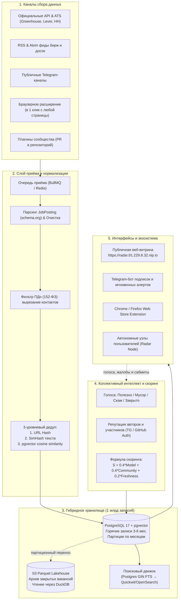

# Open Radar — Философия, Дорожная карта и Бэклог проекта

> **Дата актуализации:** 23 октября 2026 г.  
> **Проект:** Open Radar (ранее radar-oss)  
> **Миссия:** Создать крупнейшую в мире открытую, честную и децентрализованную библиотеку вакансий и задач, где качество данных регулируется коллективным интеллектом сообщества.

---

## 1. Ценность и Философия Open Radar

### Почему традиционные джоб-борды и биржи устарели
1. **Колодцы и монополии:** HH.ru, Kwork, FL, Upwork и LinkedIn заставляют соискателей и фрилансеров мониторить десятки вкладок, платформ и каналов.
2. **Монетизация мусора:** Платформы берут плату за публикации, поэтому им выгодно годами держать «мёртвые» вакансии, накрученные отклики и сомнительные проекты.
3. **Платный доступ к человеку:** Плата за контакт, плата за отклик, плата за поднятие резюме. Индустрия превратилась в выкачивание денег из тех, кто ищет работу.

### Манифест Open Radar
1. **Открытость и нулевая комиссия:** Никакой платы за поиск, просмотр карточек или переход к контакту. Информация о труде должна быть свободной.
2. **Коллективный отбор (Community Curation):** Лучший фильтр против скама, мошенников и неактуальных объявлений — не закрытый корпоративный алгоритм, а голос реальных людей, подкреплённый репутацией.
3. **Децентрализация (Hub + Nodes):** Каждый волен запустить личный легковесный Radar на своём сервере, либо подключиться к общему хабу сообщества.
4. **Уважение к приватности (Privacy First):** Никакого хранения персональных номеров телефонов заказчиков. Карточка содержит только суть задачи и прямую ссылку на первоисточник.
5. **Zero Bullshit & Zero Emoji:** Интерфейс строится по стандартам строгой швейцарской типографики и минимализма (стиль OpenAI / xAI / ProfiPass): только данные, линии-разделители, фокус на содержании.

---

## 2. Технологический стек 2026 года: Что мы используем и внедряем

Исходя из технологического ландшафта на **октябрь 2026 года**, система строится на современных компонентах:

1. **PostgreSQL 17 + pgvector (halfvec FP16 + HNSW):**
   - Переход на `halfvec(384)` сокращает потребление RAM векторными индексами в 2 раза по сравнению с float32 при сохранении точности >99% в дедупликации.
2. **DuckDB + Parquet Lakehouse:**
   - Горячее окно (3–6 месяцев) живёт в партиционированном PostgreSQL на NVMe.
   - Всё, что старше 6 месяцев, архивируется в сжатые Parquet-файлы на S3/MinIO. DuckDB обеспечивает аналитические выборки по миллиарду строк за миллисекунды прямо из S3.
3. **Очереди BullMQ (Redis Valkey) + Streaming:**
   - Для парсеров и скраперов сообщества используется изолированная очередь с экспоненциальным бэкоффом и защитой от падений, не нагружающая транзакционный Postgres.
4. **Hono + TypeScript v5.8 / Node 22 LTS:**
   - Максимальная скорость обработки HTTP-запросов (миллионы запросов на скромном сервере) при 100% строгой типизации.
5. **Quickwit / OpenSearch (следующий уровень масштабирования):**
   - Quickwit — открытая альтернатива Elasticsearch/OpenSearch на Rust, хранящая поисковый индекс прямо в объектном хранилище (S3-native search), что удешевляет поиск по миллиарду документов в 10 раз.

---

## 3. Архитектурная схема Open Radar

---

## 4. Дорожная карта (Roadmap) Open Radar

### Этап 1. Фундамент и запуск Open-Source движка (Выполнен)
- [x] Полный отказ от SQLite, перевод на чистый PostgreSQL 17 + `pgvector`.
- [x] Автоматические миграции БД с PostgreSQL Advisory Lock (`radar migrate`).
- [x] Устранение уязвимостей безопасности: Session ID в куках, защита от SSRF, Stored XSS и CSRF Origin Guard.
- [x] Воронка откликов (`new` → `interesting` → `applied` → `in_work` → `rejected`) и обратная связь (+10/-20).
- [x] Полнотекстовый поиск с русским стеммингом через GIN `to_tsvector`.
- [x] Параллельный конкурентный опрос источников (`pLimit`).
- [x] Открытый гостевой доступ (`RADAR_PUBLIC_READ=true`) на `https://radar.91.229.8.32.nip.io`.
- [x] Автоматизация релизов в GitHub Actions (Docker + ZIP расширения).
- [x] Миграция схемы сообщества: разделение `job` / `gig`, таблицы `app_users`, `lead_votes`, `lead_duplicates`.

### Этап 2. Расширение и краудсорсинговый сбор (Q4 2026 — Текущий спринт)
- [ ] Публикация расширения в Google Chrome Web Store и Firefox Add-ons.
- [ ] Добавление всплывающих уведомлений в расширении: «Заказ добавлен в Open Radar» со ссылкой или «Уже в базе (дубликат)».
- [x] Поддержка автоматического извлечения разметки `schema.org/JobPosting` со страниц вакансий при клике на расширение.
- [x] Переключатель типа в расширении: «Вакансия» (`job`) или «Заказ» (`gig`).

### Этап 3. Open Radar Community Hub MVP (Q1 2027)
- [ ] Авторизация пользователей без паролей: вход через Telegram Login Widget и GitHub OAuth.
- [x] Интерфейс голосования на сайте: кнопки Полезно, Мусор, Скам, Закрыто под карточками.
- [ ] Репутационный движок: расчёт веса голоса в зависимости от истории аккаунта, защита от бот-ферм и накруток.
- [ ] Форма «Добавить по одной ссылке»: автоматический скрапинг и превью перед публикацией.
- [ ] Подключение 25 новых открытых коннекторов (Habr, Kwork, FL, RemoteOK, Работа России, ATS Greenhouse/Lever).

### Этап 4. Масштабирование до сотен миллионов строк (Q2 2027)
- [ ] Вынос очередей скрапинга в BullMQ (Redis/Valkey).
- [ ] Автоматическая выгрузка закрытых партиций старше 6 месяцев в Parquet на S3.
- [ ] Интеграция Quickwit для полнотекстового поиска прямо поверх S3 без переплаты за RAM.
- [ ] Кросс-платформенная дедупликация на эмбеддингах (`halfvec` HNSW).
- [ ] Telegram-бот с персональными подписками по стеку, городам и бюджету с дайджестами.

---

## 5. Полный бэклог задач (Product & Engineering Backlog)

### Эпик A: Веб-интерфейс и UX сообщества
- [x] **TASK-A1:** Отрисовка кнопок голосования (`полезно`, `мусор`, `скам`, `закрыто`) на странице карточки лида `/leads/:id`.
- [ ] **TASK-A2:** Внедрение Telegram Login Widget на страницу `/login` и в шапку сайта.
- [ ] **TASK-A3:** Форма добавления «Вставить ссылку» (`/submit`): ввод URL → фоновый fetch метаданных через OpenGraph/JobPosting → предпросмотр → публикация в 1 клик.
- [ ] **TASK-A4:** Личный кабинет контрибьютора (`/profile`): список добавленных вакансий, история голосов, бейджи репутации.
- [x] **TASK-A5:** Фильтр в поисковой строке по типу: таб `Все` / `Заказы (Gig)` / `Вакансии (Job)`.

### Эпик B: Браузерное расширение (Chrome / Firefox)
- [x] **TASK-B1:** Доработка попапа расширения: выбор радиокнопки `Заказ` / `Вакансия` перед отправкой.
- [x] **TASK-B2:** Интеграция парсера микроразметки `schema.org/JobPosting` в `content.js` для мгновенного захвата названия компании, вилки ЗП и стека.
- [ ] **TASK-B3:** Отображение тоста-статуса после нажатия Alt+Shift+R с прямой ссылкой на созданную карточку в хабе.
- [ ] **TASK-B4:** Подготовка ассетов для Chrome Web Store: промо-баннеры 1280x800, скриншоты, манифест политики конфиденциальности.

### Эпик C: Коннекторы и парсинг сообщества
- [x] **TASK-C1:** Создание CLI-генератора нового коннектора: `pnpm new:connector <name>` (создаёт каркас, фикстуру и тест).
- [x] **TASK-C2:** Коннектор к API «Работа России» (Trudvsem Open API) — официальный источник без риска блокировок.
- [ ] **TASK-C3:** Коннектор к ATS Greenhouse / Lever (парсинг открытых страниц карьеры технологических компаний).
- [ ] **TASK-C4:** CI smoke-тест коннекторов: ночной запуск тестов на фикстурах с генерацией бейджа «Active / Broken» в README.

### Эпик D: Анти-абьюз и Репутация
- [x] **TASK-D1:** Реализация формулы веса голоса `w = min(reputation, 5.0) * age_factor` в API эндпоинте `/api/leads/:id/vote`.
- [ ] **TASK-D2:** Задержка учёта голосов для аккаунтов моложе 7 дней (холд 24 часа).
- [x] **TASK-D3:** Автоматическое скрытие лида из публичной ленты при достижении порога `votes_scam >= 3 && votes_scam > votes_up`.
- [ ] **TASK-D4:** Очередь жалоб `/admin/reports` для модераторов сообщества.

### Эпик E: Масштабирование данных и Архивация
- [ ] **TASK-E1:** Настройка фонового джоба выгрузки устаревших партиций `leads` в формат Apache Parquet.
- [x] **TASK-E2:** Оптимизация векторного индекса HNSW в Postgres 17 с переходом на `halfvec(384)`.
- [ ] **TASK-E3:** Прототип коннектора Quickwit для распределённого поиска по архиву на S3.
